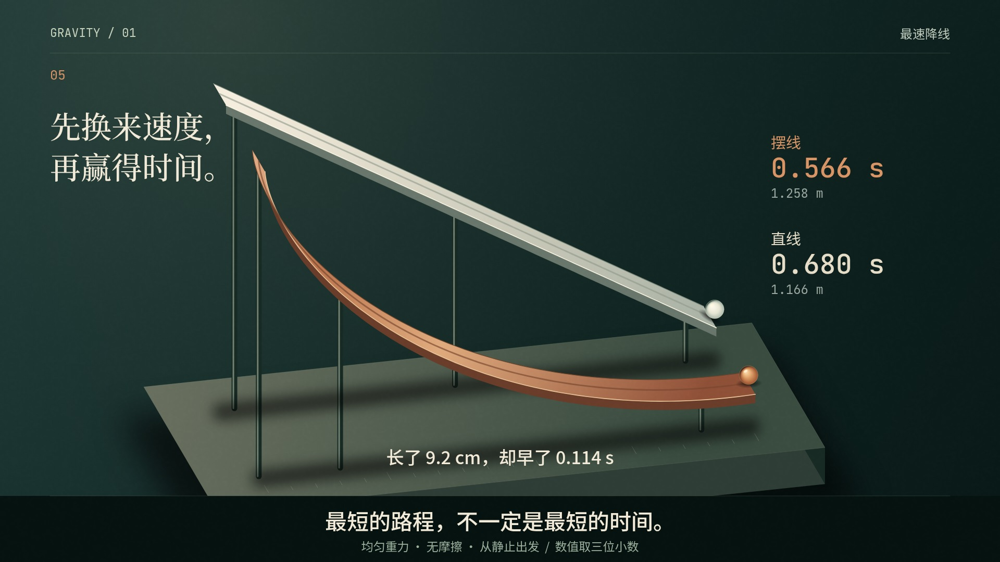

# vibe-knowledge-film

你一定见过这种视频。最近抖音上爆火的 Vibe 知识大赏，看完收获满满。

这种视频到底怎么做？我做了一个 skill，可以一键生成这种类型的视频。成片在下面。

原版有两种视觉世界：「夜曲」适合讲底层、难懂的知识；「寓言」把心理、行为逻辑直观演给观众看。本分支保留这两套设计，并增加按主题制定原创视觉方向的工作流。

用的时候，给 Agent 一个选题或文案。Agent自主核对事实、比较叙事与视觉方案、确定美术和音乐、写完整分镜、制作与返工，最终交付完整有声MP4。时长由知识内容和观看节奏决定；关键帧、Motion Strip和短试片是内部验证，通过后自动继续全片，不需要用户逐阶段批准或发送“继续”。

原理不复杂。用 Canvas 和 JavaScript 把每一帧画出来，驱动浏览器一帧一帧截图，压成视频，再混上声音。字体都是开源的。说白了，就是用代码做这样一条视频。

## 本次升级与可检查的作品

电影美术方向[Obsidian & Gold · 曜石鎏金](references/art-direction.md)提供按主题选择的暗金全片/局部母题/不采用判断，以及独立的文字、灯光、真实倒角和表面组件；不改旧B/C默认，也不强制黑底。新的14秒知识镜头《力的远近》使用同一2 N静载与真实网格力臂计算，验证0.35→0.70 m时力矩0.70→1.40 N·m：[源码/事实/用法](examples/torque/README.md) · [现有有声MP4与手机对照](evidence/torque/mobile/README.md) · [首版光影/材质对照](evidence/torque/README.md)。不是新一部多分钟影片，也不把配色变化或技术通过当作电影品质证明。

手机横屏检查已纳入正式生产：从最终MP4生成390/320px原始与H.264压力副本，记录声明文字的有效尺寸/越界风险，供Agent实际看图返工。[移动端方法](references/mobile.md) · [最终性能与修复验收](evidence/qa-closeout/README.md) · [《力的远近》同刻返工与新版成片](evidence/torque/mobile/README.md)。压力参数不是抖音官方转码，技术成功不代表阅读舒适度通过；仍保留1080p母版与旧片。

本轮导演重点是：**好的知识电影，不是告诉观众一个正确答案，而是带他亲眼经历答案为什么成立。** 分镜现在记录观众进入/离开的认知，分开个人体验、研究证据与理论/类比，不把文献目录或精致动画当成故事。

镜像题的方法验证工程《另一种你》围绕“为什么镜子里的你，有时比照片好看”：同一虚构人像只翻转，1977研究的真实多数偏好计数，再用独立三维模型控制相机距离，最后带新理解回看开场。[源码/事实/分镜](examples/mirror/README.md) · [制作状态、画面与技术报告](evidence/mirror/README.md) · [参考片真实研究](evidence/director-story/reference-study.md)。白熊和镜像的[两题故事候选](references/story-cases.md)保留为方法案例，镜像工程已导出112秒技术版，后按用户要求停止原创作品开发；不把它记为完成主观验收的作品，也不继续扩张样片工作。

[轻音乐制作](references/light-music.md)提供授权真实钢琴音符bank与共享时钟乐句；没有新增Python依赖。图像使用保比例放置器，避免把镜中人像拉瘦制造偏好。成片的技术、编码同步、声明条件、完整观看与听审分别记录，不把正常响度当舒适听感。


完整原创《地图是一种选择》（72秒、1080p30发行版）：[有声MP4](https://raw.githubusercontent.com/Xuanyi-king/vibe-knowledge-film/feat/director-evidence-workflow/evidence/atlas/final.mp4) · [源码、事实、分镜与用法](examples/atlas/README.md) · [首版到最终关键帧与验收](evidence/atlas/review.md)。从一句主题出发，完整解释纬圈、长度尺度、面积和投影取舍；复用D3地理几何、共享事件、原创分轨配乐和实际绘制条件，不再每次手写海岸线与投影。

[自主主题到成片](references/production.md)提供Agent内部流程；`python scripts/produce.py <project> [--assets geo scene]`统一执行已编写作品的技术生产与检查，不取代Agent的创作判断。输入指纹把画面、事件、参考混音和最终媒体绑定；过期或无版本产物会拒绝合音/检查。编码同步、声明的视觉动作条件和主观审片分开验收，具体平台与限制见[最终验收](docs/final-acceptance.md)。

8秒原创《一击之后》的几何验证修正版（原片保留）：[有声MP4](https://raw.githubusercontent.com/Xuanyi-king/vibe-knowledge-film/feat/director-evidence-workflow/evidence/resonance/current.mp4) · [源码、关键帧、返工与分轨](examples/resonance/README.md)。共享事件驱动敲击、回弹、余振、阻尼、相机和音乐；模型可调用解析运动、真实深度/PBR、材质音色、采样与分轨自动化，不必每镜重写算法。

[视听编排调用手册](references/choreography.md)按需加载；[开源融合取舍](docs/capability-integration.md)记录源码与许可。最终AAC已回测调度同步；音色与完整节奏仍需人工听音，不宣称仅靠技术报告完成专业审片。


原创 36 秒《先换来速度》：为什么更长的摆线比直线更快？从实体实验、同一时刻的速度比较，过渡到生成曲线的几何模型。

[](https://raw.githubusercontent.com/Xuanyi-king/vibe-knowledge-film/8c93e14809b839586ab4652cf1e89b2a03876717/evidence/descent_studio/final.mp4)

- [升级版有声 MP4](https://raw.githubusercontent.com/Xuanyi-king/vibe-knowledge-film/8c93e14809b839586ab4652cf1e89b2a03876717/evidence/descent_studio/final.mp4) · [原版流程有声 MP4](https://raw.githubusercontent.com/Xuanyi-king/vibe-knowledge-film/8c93e14809b839586ab4652cf1e89b2a03876717/evidence/descent_baseline/final.mp4)
- [源代码与分镜](examples/descent_studio/) · [同题对照、返工证据与已知限制](docs/experiments/director-2026-10/README.md)
- [导演决策](references/directing.md)、[视觉实现配方](references/craft.md)、[按时间点返工](references/review.md)按需加载，主 Skill 保持简短。
- 渲染失败、非确定性和事件异常会返回失败；raw/clip 渲染成功后才替换对应视频。新增媒体诊断与回归测试，继续使用原来的 seek、sheet、motion、clip 和并行渲染。

本轮新增[6秒复杂机构镜头](examples/governor_scene/README.md)：通过可选Three.js层复用真实深度、PBR材质、阴影、杆件和旋转体几何，减少轻量模型手写图形算法的负担。[复杂场景制作方法](references/complex-scenes.md)说明适用边界；Canvas旧工程无需安装该依赖。

`render.py --resume 4`提供正式的持久分段、输入/浏览器/编码参数身份校验、损坏检测与续跑；`audio.py`也在临时输出通过验证后才替换旧成片。两部原样片未重做；大MP4使用历史commit固定链接，短验证片、新72秒完整片和压缩独听轨随证据追踪，SHA256见[evidence/assets.json](evidence/assets.json)。当前环境的Release附件上传返回401，未宣称发布成功。重复帧和恢复临时记录已清理，源码与关键同刻对照保留。

这两个创作臂的简报不完全一致：升级臂额外收到铜/陶瓷美术方向提示，不能据此隔离证明Skill提升了模型能力。它们是非盲案例，没有调用DeepSeek。新的[中性提示小对照工具](docs/model-probe.md)默认只准备请求，提供任意兼容提供商的凭据、端点和精确模型ID后才能运行。当前无目标模型结果；此前提到的Opus参考片当时未提供；本轮另上传的《运气的形状》已实际读取，检查范围见上方参考片研究。

## 夜曲：《折叠》

题目是蛋白质折叠，2024 年诺贝尔化学奖。这里是开头 33 秒。


## 寓言：《鸽子的迷信》

一只鸽子怎么变得迷信。这里是开头 33 秒。


## 安装

把这个目录放到 Agent 的 skill 目录，文件夹名保持 `vibe-knowledge-film`。Claude Code 的常见位置是 `~/.claude/skills/vibe-knowledge-film`。交给 Agent 的流程在 `SKILL.md`。

```bash
pip install -r requirements.txt
python -m playwright install chromium
python engine/get_fonts.py
```

还需要 ffmpeg 和 ffprobe。渲染器优先使用本机 Google Chrome，缺失时使用 Playwright Chromium；也可用环境变量 `VK_BROWSER` 指定浏览器路径。字体是 SIL Open Font License，不放进仓库，所以要先跑一次 `get_fonts.py`。完整 [Windows PowerShell 命令](docs/windows.md)。

在你自己的项目里建工程，不要建在这个 skill 目录里。

```bash
# Agent先完成事实、艺术方向与完整分镜，再填入它选定的world和秒数：
python scripts/new_film.py <工程目录> --world <B或C或custom> --duration <完整分镜秒数>
python engine/render.py <工程目录> --serve
```

`--world` 用 `C`（夜曲）、`B`（寓言）或 `custom`（无辉光/颗粒的中性起点，同时生成 direction.md）。无world不再默认夜曲且不创建工程；custom还必须指定正数duration。正式创作一律先决定时长再建工程，用户无需选择这些技术参数。显式B/C旧命令省略duration仍保留30秒占位并发出警告；原B/C工程无需迁移。已有film.js默认不会被覆盖，需要明确`--force`。命令和写法见[engine](references/engine.md)。

```bash
python -m unittest discover -s tests -v
python scripts/produce.py examples/atlas --assets geo --chunk 4 --jobs 1
# 单个底层命令仍兼容：见 references/engine.md
```

媒体诊断验证编码、时长和音轨，输出黑段/静音/切换候选；它不判断审美，也不能自动证明字幕无遮挡、事实正确。须结合实际画面审查。

## 许可

引擎、脚本和文档里的方法说明使用 MIT 许可，见 `LICENSE`。

`references/analysis.md`、`references/historical-prompts.md` 里按成片填好的 brief，以及 `examples/stim_B`、`info_C`，字幕和画面设计来自他人的短片，版权属于原作者。这两段是学习对照，不要当成自己的作品发布。

本次 descent、governor_scene、resonance、atlas 原创作品的代码、程序化画面和合成音轨为本任务原创，随仓库 MIT 许可提供。未复制调研项目的视听素材；可选D3/Three运行库和Natural Earth数据单独保留许可，依赖与调研许可边界见 [THIRD_PARTY_NOTICES.md](THIRD_PARTY_NOTICES.md)。


系列音乐支持[音乐导演与外部剪辑适配](references/music-direction.md)：signature/original/custom复用现有VK_SCORE；有合适授权时优先考虑用户指定候选《We Never》，当前身份未确认且未分发原曲。没有音源自动回到合适原创/授权替代。[真实参考音轨分析与边界](evidence/music-direction/README.md)。
