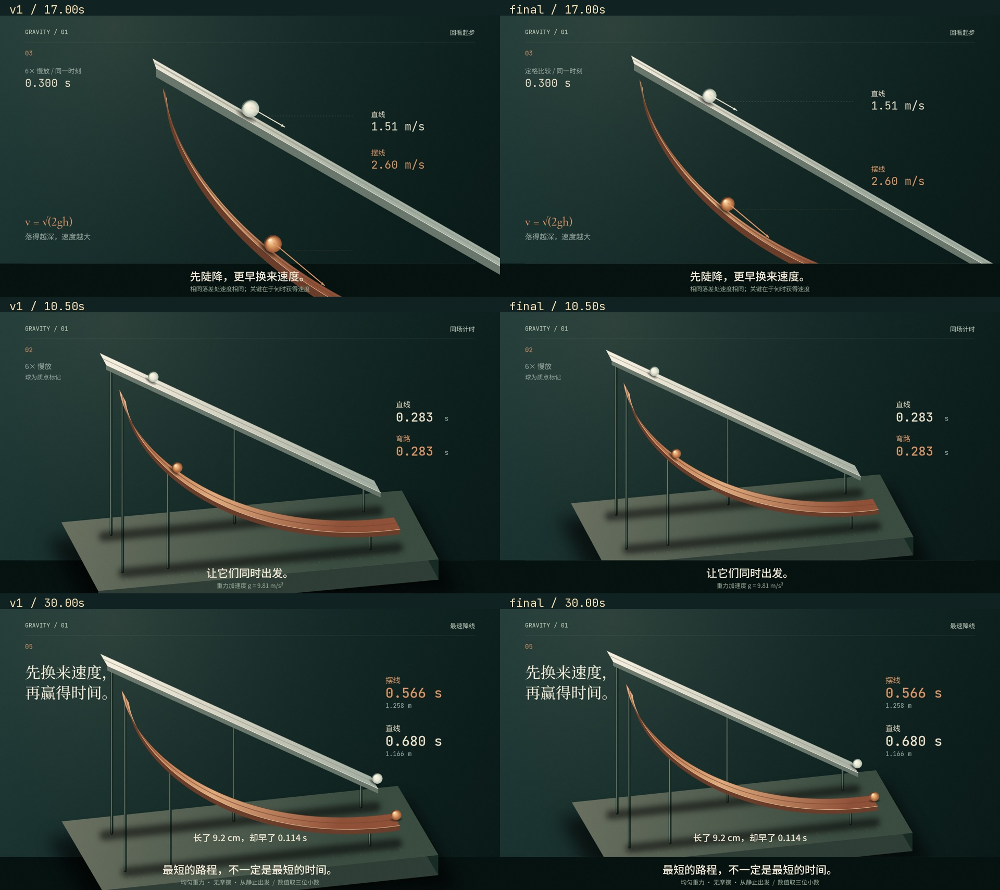
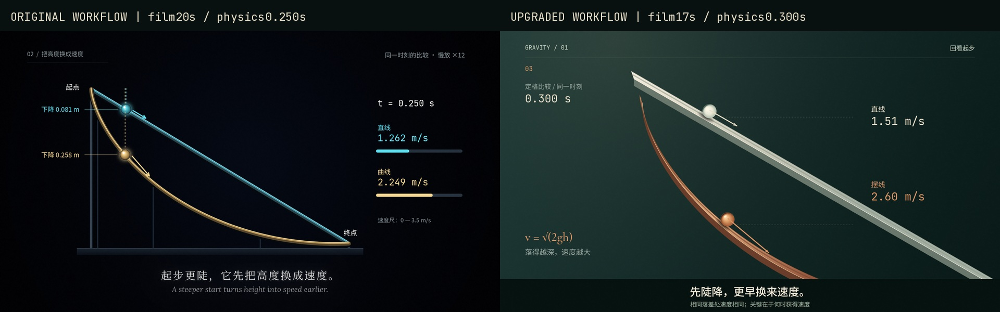

# 原创影片与工作流对照

本次交付以真实画面为依据：保留原版流程创作的《抢先一步》，与新版流程创作的《先换来速度》同题比较。两片都是36秒、1080p、30fps、无旁白的原创程序化作品。

## 先看作品与证据

| | 原版流程 | 升级流程 |
|---|---|---|
| 有声成片 | [final.mp4](../../../evidence/descent_baseline/final.mp4) | [final.mp4](../../../evidence/descent_studio/final.mp4) |
| 源码 / 事实 / 分镜 | [descent_baseline](../../../examples/descent_baseline/) | [descent_studio](../../../examples/descent_studio/) |
| 实际创作输入 | [brief.md](../../../examples/descent_baseline/brief.md) | [brief.md](../../../evidence/descent_studio/brief.md) |
| 图像返工记录 | [production-notes.md](../../../examples/descent_baseline/production-notes.md) | [review.md](../../../examples/descent_studio/review.md) |
| 关键帧 / 动作 | [证据目录](../../../evidence/descent_baseline/) | [最终帧与Motion Strip](../../../evidence/descent_studio/final/) |

升级片初版到最终版的同刻变化：



17秒初版把速度箭头推入字幕区；返工改变取景尺度、标注位置，并明确冻结同一物理时刻。底座与字幕的冲突则通过缩小全景、统一字幕遮罩解决。没有通过增加特效掩盖问题。首版、第一轮、最终源码和截图均保存在 evidence 中。

## 条件、可比性与结论边界

两名独立上下文子代理在首次创建时继承同一个会话模型，分别只读原版或新版指导；没有相互读取源码、画面。精确底层API模型ID、token数与账单不可得。没有调用DeepSeek，也没有用户提及的Opus参考视频文件。**不能由本实验推断DeepSeek已经提升或接近参考片。**

共同条件：相同主题、端点Δx=1m/Δy=.6m、g=9.81、无摩擦质点静止释放；相同字体、Canvas引擎家族、Chromium、FFmpeg、输出规格、MathWorld来源；最多约20分钟主动创作预算及两次图像主导返工，渲染等待另计。没有图像生成、付费素材或其他模型调用。

关键混杂：升级臂的初始brief额外建议了陶瓷/铜轨道、体积球、接触阴影和摄影机，并要求比较两个机制。两份原始brief已保留。因此这是**包含导演指导的工作流案例对照**，不是只替换SKILL.md的严格受控实验。两个臂实际主动用时也未精确配平；n=1、创作者自审、父任务及独立代理非盲审，均限制因果解释。

原版引擎固定在`62d51508aad00003dc6209afa80c4b5dc540de59`；只用仓库外启动shim把Chrome路径换为本机Chromium，未编辑原版引擎。新版修复渲染失败传播，但没有引入新的视觉框架或美术素材。原始工作树在`/workspace/vkf-baseline`，提交后的baseline样片源码复制到本分支便于检查。

## 实际画面的比较

以下是对已访问静帧和Motion Strip的非盲判断，不是观众理解实验或数值审美评分。



这里比较各片的速度解释镜头，不是同一物理时刻的受控截图：左片t=.250s、右片t=.300s。升级片自身的返工证据使用相同影片时刻。

| 维度 | 可见证据与判断 |
|---|---|
| 创意 | 两片都选择同条件赛跑，不能称为完全不同构思。新版另探索速度纸带方向并舍弃；最终增加“实体装置→圆周点生成摆线”的模型转换，拓展解释方式。 |
| 空间与材质 | 新版10.5秒有轨面/侧壁、前后双轨、支杆、底座、球体接触影；原版20秒以正面轨道和背景发光呈现，关系更扁平。新版实体层次更明确，仍是屏幕空间近似，并非物理渲染。 |
| 清晰度 | 原版共同端点、落差尺、同刻落差读数和速度条更直接。新版17秒速度向量更大、同刻定格更从容，但双轨深度错开可能让人误读为不同高度；5秒条件字幕和端点连接线说明并置条件。不能声称清晰度全面胜出。 |
| 镜头与统一性 | 原版围绕一个正面装置反复揭示并有独立片名卡；新版以近景提问、全景比赛、近景速度证据、几何模型及全景回场改变观看尺度，陶土铜/象牙色语义持续。新增几何镜头为明确剪切，未伪称无缝变形。 |
| 运动 | 两片都按解析物理计算，未给质点运动套ease。新版8.8–13.2秒动作条显示同步释放、加速与先后到达；原版21.2–22.6秒动作条显示复位提示。离散采样不能证明每帧的接触与可读性。 |
| 返工 | 两片都完成两轮看图修订，原版也能自主发现并解决布局问题。新版留下更完整的同刻源码/帧/根因记录，但没有精确工时数据支持返工效率提高。 |
| 技术与成本 | 实际测试、编码、音轨和渲染时间见[验证记录](verification.md)；没有可用token/金额数据，不报告虚构节省。环境中断与资源竞争使本次渲染墙钟不适合比较引擎速度。 |

可支持的结论：这次新版工作流产出了更丰富的镜头尺度、实体层次和几何解释，并通过实际画面完成局部返工；同时保留了原版更直接的标注作为后续改进依据。它是可审阅的改进案例。**“同一轻量模型普遍创作更好”这一最高验收问题仍待中性brief、多题材、多次采样和真实观众评审验证。**

## 复现与继续验证

新版/复制后的基线可在本分支直接运行；[Windows PowerShell](../../windows.md)提供安装和完整命令。若要严格复现原版运行时，应另建原始commit工作树，把baseline工程复制进去，再使用同一浏览器和字体版本渲染；不要把新版引擎下重渲称为原版运行时复现。

```bash
python engine/render.py examples/descent_studio --det
python engine/render.py examples/descent_studio --jobs 3
python engine/render.py examples/descent_studio --events
python engine/audio.py examples/descent_studio
python scripts/check_media.py examples/descent_studio/renders/final.mp4 --duration 36
```

补做严格模型实验时，给两臂完全相同的中性brief，只替换Skill/按需参考文件；固定模型精确版本、参数、输入资料、总token/时间预算、渲染环境和返工轮数。中性brief示例：

> 制作36秒1080p/30fps无旁白中文知识片，解释同端点Δx=1m、落差.6m、g=9.81、无摩擦质点静止释放时，直线与摆线用时为何不同。依据两篇MathWorld来源，保留事实、分镜、源码、首版与返工图、最终影片及成本日志。自行选择视觉方案。最多20分钟主动创作、两次实际图像返工；不使用其他模型或外部美术素材。

至少跨三个主题重复，每题多次独立采样；把最终片随机化交给不知版本的评审，分别判断知识理解、镜头完成度、艺术表达和观看意愿。模型接入由使用者提供，不在本次无凭据环境伪造结果。

审计、外部方法与许可证取舍见[audit.md](audit.md)、[research-commits.md](research-commits.md)；实施计划与约束见[plan.md](plan.md)。
