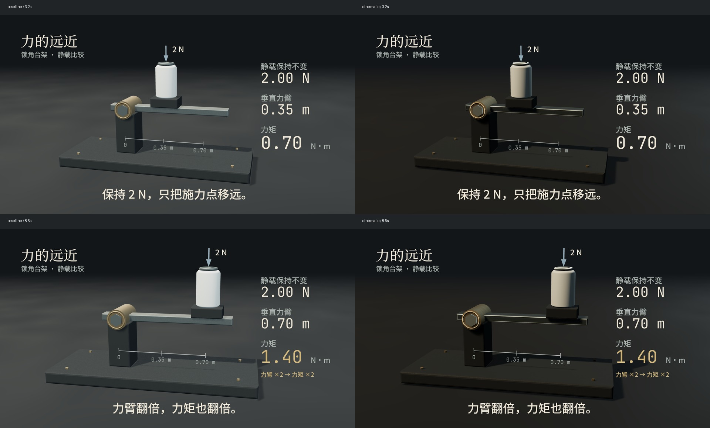
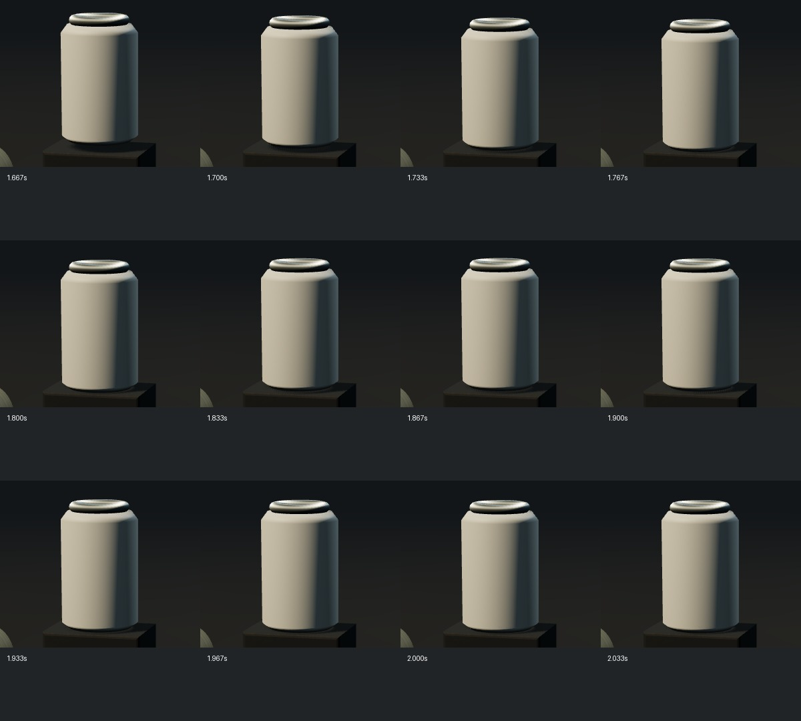
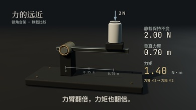
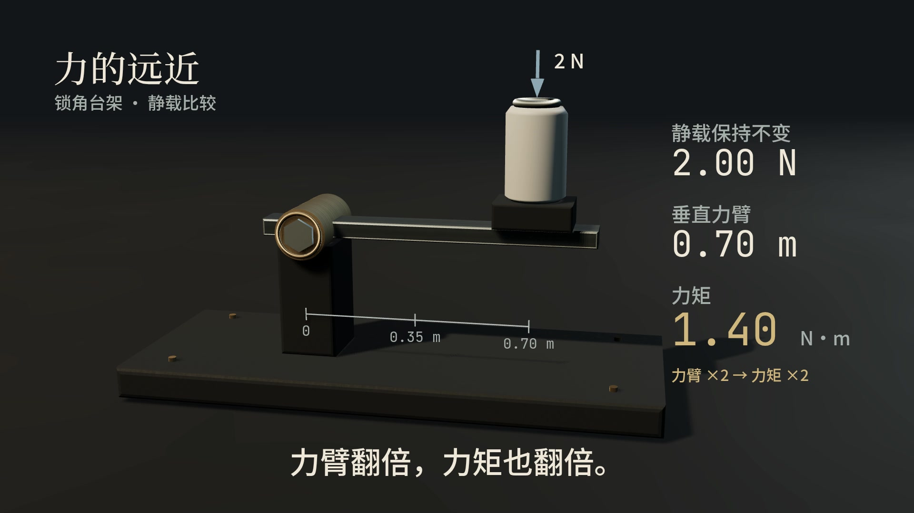
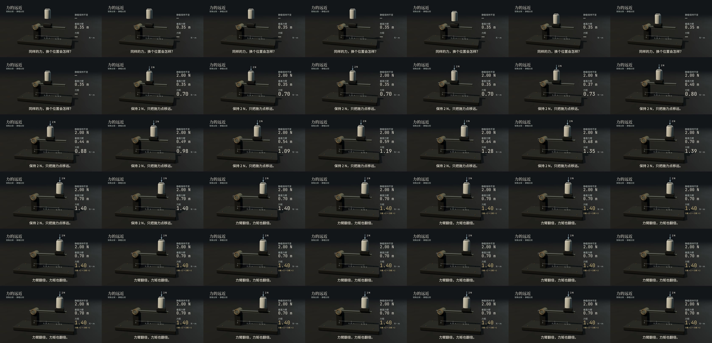

# 力的远近 · 曜石鎏金实证

14秒原创知识镜头：锁角台架上保持2 N静载，把垂直力臂从0.35移到0.70 m，力矩从0.70变为1.40 N·m。读数来自实际网格世界位置的叉积。受控落放不是自由碰撞实验，静载显示在落定后才出现。

[观看/下载有声MP4](final.mp4) · [音乐独听](music.flac) · [触感音独听](sfx.flac) · [源码、分镜、出处与复现](../../examples/torque/README.md) · [可复用美术能力](../../references/art-direction.md)。

正式produce输出：1920×1080、30fps、420帧、14.000秒，H.264/yuv420p + 48 kHz AAC。MP4为1,610,192字节，SHA256：`bf9b26e8a2e12fa8f8e7cae228fdf42b5b0bf4486fadf638c66fe18f228bec60`。短片及必要证据随Git持久化，不依赖临时CI产物；[文件校验清单](artifacts.json)，[固定提交的原文件地址](../assets.json)不会随开发分支删除而失效。此前112秒《另一种你》未改动，仍是原有本地存储状态，不在此轮擅自发布。

## 相同目标的画面对照

两帧分别是3.2、8.5秒。双方都有本轮倒角与排版；只比较灯光比例、环境反射与表面响应，不把旧studio描述成旧模型的最佳创作。新画面减弱均匀灰雾，用暖主光、低补光、冷轮廓和金属反射区分器具的面；主体与地面接触影仍可辨。金色只在轴件和关键关系出现。此对照不证明普通模型创作能力提升，也不是仅换配色的实验。

[首版](v1.jpg)是早期不同构图，不能作为受控A/B：主体偏远、盒状造型明显，后改倒角、支撑、机位与字幕空间。第二轮移开贴顶的力标注；随后实际画面暴露字体声明遗漏，复用正式HTML字体声明并增加缺字族失败测试，避免系统回退。乱序seek发现标注4–5px偏移，修复公共相机世界矩阵更新，增加真实Three投影和PNG重放测试。

此条带是正式seek输出，1.667–2.033秒，每格1/30秒；不是最终编码视频抽帧。载荷接触与音效共用1.8秒事件；几何间隙另由声明条件验证，不以波形对齐推断物体接触。

主字幕和读数可读；辅助标尺、台架条件需大屏观察，不承担主要解释。文字框检查不等同于像素遮挡检测。

## 最终编码与技术验收

后图是FFmpeg从最终MP4按3fps抽出的42帧，按行从左到右阅读，约每1/3秒一格。实际检查了落放、相机推进、滑移、读数递变、金色关系揭晓和末段观察停顿；没有把抽样图当作连续实时播放。接触12帧条带补足这一抽样遗漏的短动作。

- [production](production.json)：`technical_complete_needs_subjective_review`。四段各3.5秒，经持久缓存/合片、事件导出、分轨、母带、双层同步和媒体检查。源码/事件/输出指纹一致。
- [编码同步](encoding-sync.json)：14个有声事件通过，波形估计lag均0；最小相关0.99279。容器时长比较差0.016秒。不代表视觉动作必然正确。
- [声明视觉条件](visual-sync.json)：8项均通过。1.7667秒间隙1.143 mm；1.8000秒接触间隙约0；1.8333秒受控回弹3.715 mm；7.8667秒实际力臂0.70 m、2 N、叉积1.40 N·m。揭晓相对音乐锚点的视频量化误差9.524 ms。这只验作者声明的渲染状态条件，不是通用图像语义识别。
- [母带](mastering.json)/[媒体](media.json)：编码后−18.05 LUFS、−3.5 dBTP、LRA 4.4 LU，未检出黑帧/规格错误。唯一静默候选7.3268–7.6911秒与7.4–7.7秒设计停顿附近的淡出重合；阈值候选不是艺术判定，仍需听审确认呼吸与接续。
- 原始钢琴采样电平低，母带以全段共同+23.61 dB增益达到目标，未单独把音效抬响。两条FLAC独听也是同一增益后的分轨，未单独响度归一；MP4包含完整混音，不额外追踪重复的混音FLAC。

JSON中的workspace路径与review/visual截图名是制作时的本地溯源记录；公开图像采用本页精选JPEG/条带，不另存六份近重复全尺寸PNG。comparison.json的png_sha256对应捕获时原始PNG；实际归档JPEG与MP4/分轨的校验用artifacts.json，二者不混用。

## 验证边界

- 本地完整回归：82项通过，无跳过，589.018秒；[实际日志](local-tests.log)。另以软件WebGL运行4项灯光/材质/倒角/相机组件测试通过，[日志](software-gl-tests.log)。
- 独立只读代码审查及上述图像检查未发现阻塞问题；没有运行额外电影或听审。
- 原B/C各一帧精确PNG SHA与此前基线完全一致，见[回归](legacy-regression.json)。Linux/Windows原生CI结果与实际耗时见[新PR #2的检查与验收说明](https://github.com/Xuanyi-king/vibe-knowledge-film/pull/2)。核心不装Three（预计12项可选跳过），随后另装现有Three执行4项组件烟测；不把本地结果外推到Windows整片。可选旧8秒全WebGL任务未在本轮重复执行。
- 已实际检查关键帧、接触中间态、390像素缩图及最终MP4的3fps全段抽样；尚未进行连续播放的完整动态观看与主观听音。不能声称电影感或舒适音乐听审通过。
- 没有同模型公平创作对照；一个器具镜头不代表其他题材或弱模型效果保证。没有真实面积光阴影、路径追踪、SSAO或光学景深实现。

## 音乐与授权

原创84 BPM钢琴四个乐句，接触与滑动仅用两种低强度反馈；7.4–7.7秒安排短暂停顿，发现与共享beat 11锚点呼应，最后留出收束。BPM、乐器、道具与轨迹均在作品，不在艺术组件内。音符来自已核对CC0的VSCO2 CE/Ivy Audio录音，仅准备所需5个音符；原始来源、固定commit、SHA与许可在源码piano.json/assets。没有使用参考影片画面或配乐；本轮没有新增依赖。
