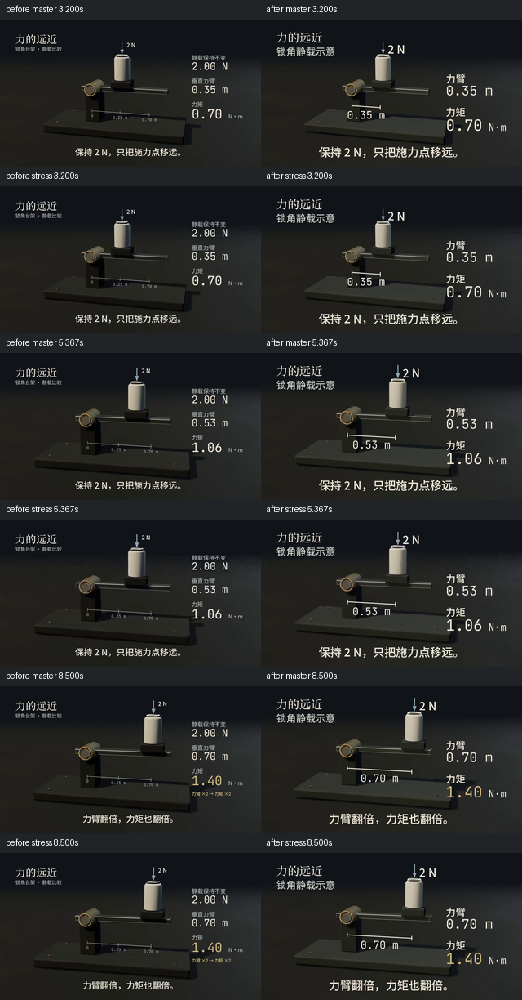

# 《力的远近》手机返工：保留电影构图，重做信息层级

[新版有声母版](final.mp4) · [720p/CRF30压力副本](stress.mp4) · [原版及其证据](../README.md) · [源码](../../../examples/torque/README.md) · [通用手机QA](../../../references/mobile.md)

新版实际1920×1080、30fps、420帧、14秒、H264/yuv420p+AAC48kHz，1,665,320字节，SHA256 `0a0b8a574f35b4538f5eaa6fd3ea3fc9b762fc1eef223aecc7806921e5c4293e`。原版1,610,192字节，SHA `bf9b26e8a2e12fa8f8e7cae228fdf42b5b0bf4486fadf638c66fe18f228bec60`，未覆盖。相同score/动作/时长，双方AAC压缩负载完全相同：[检查](audio-preserved.json)。本页是技术与实际缩图证据，未认领完整动态观看或听音通过。

## 实际问题与改法

旧版源排版在320px等效宽度：42px约7屏幕像素，25px约4像素；微小尺标不是CRF14能救的。字体实际加载、固定坐标与字宽检查正常，未发现自动缩字。原始母版已看不清微字，压力重编码加重损失；不把源码问题归咎抖音。

- 删除可有可无的重复2.00N侧栏和小金字关系，保留载荷旁清楚的2N。
- 用连接**实际轴心/施力点投影**的随动尺寸线代替0.35/0.70微小固定刻度；中间0.53m也来自同一模型，不手动跳读数。
- 右侧只保留力臂和力矩，数值/单位分层。底字幕与静载条件逐镜覆盖观看任务，超宽仍失败，不压字。
- 台架增加低强度局部暖反射/略抬材质，改变摄影机目标留出底字幕；没统一提亮背景/粗描边/加辉光。金色只在最终力矩揭晓。

## 同时刻真实编码对照

3.2、5.3667、8.5秒，按每时刻先母版后压力；左右原/新，每格本身320px。距离由.35经过.53变.70、力矩由.70经1.06变1.40，2N与解释字幕在所查缩图中可识别。新的尺寸线解释“力臂在哪里”，不只是放大文字。

[390对照](comparison-390.png) · [新版320全检查点](after-320.png) · [新版390](after-390.png) · [强压力320](strong-320.png) · [强压力390](strong-390.png)。旧版[320](before-320.png)/[390](before-390.png)完整保留。全部从各自最终MP4抽帧，不用源码截图代替编码效果。

压力是1280×720/CRF30，另看960×540/CRF33，均H264/yuv420p、等比例、无裁切/锐化，音频streamcopy。**只是压力实验，不是抖音官方参数或实际上传效果**。暗部结构仍较克制，320px更适合看轮廓和因果，不要求辨认所有纹理。静帧可读不代表运动中读完，尤其最初0.70数值的稳定观察时间还需连续观看确认。

## 自动检查与未验收项

[production](production.json)：technical_complete_needs_subjective_review；4段持久渲染、确定性、事件/媒体身份正常。[phone-report](phone-report.json)绑定输入/输出SHA，7个时刻含接触前/当下/回弹、滑移中间态与完整字幕停留；390/320注册文字没有阈值风险，**status仍needs_visual_review**。布局数据只覆盖公共type，未注册文字/遮挡/真实背景对比/阅读舒适不自动通过；[强压力报告](strong-report.json)是纯MP4模式，不假称有布局数据。报告所列逐帧PNG可通过工具复现，本仓库只精选拼图，避免追踪大量重复帧。

[视觉条件](visual-sync.json)8项通过，含接触几何间隙/叉积/回弹；[编码同步](encoding-sync.json)14个有声事件通过。两者分开，不拿相关性认领视觉语义。

[母带](mastering.json)：−18.05LUFS、−3.5dBTP、LRA4.4LU；[媒体](media.json)无技术错误。7.3268–7.6911秒静默候选接近7.4–7.7设计留白；是否自然仍需听审。没有重新编配或把音乐变响。

已实际查看上述母版/两档压力的320/390缩图与中间态，对照显示关键刻度/2N/单位/字幕更清楚。仍需**完整连续动态观看、手机实机阅读、完整混音与分轨听审、实际平台上传转码**。不宣称电影感或音乐舒适性验收。没有同模型创作能力提升的公平实验。

本地完整回归104项通过、无跳过，718.408秒（与正式离线渲染同时进行）；[实际日志](local-tests.log)。原生Linux/Windows核心CI及可选组件范围见PR #2最终记录；Windows完整钢琴下载/14秒成片未实测。旧B/C回归另见本目录legacy-regression.json。

兼容收尾发现并修复一次元数据命名冲突：最初`fr.layout=[]`遮蔽旧`Frame.layout()`，只用新type的测试未覆盖`chars`路径。新增最小旧逐字排版负例先重现READY_ERROR，再将收集器独立为`artLayout`；旧B/C指定帧的精确PNG SHA重新一致。随后按新输入指纹正式重导出，不沿用已过期事件或伪造旧成片侧车。

原生Windows首轮[39240273460](https://github.com/Xuanyi-king/vibe-knowledge-film/actions/runs/39240273460)核心有一个测试失败：回滚负例比较未解析的RUNNER~1临时路径与已规范化输出，导致预期错误没有被注入。用Linux目录别名[重现同一失败](path-alias-red.log)，修正测试比较后[10项手机QA通过](path-alias-green.log)。没有修改生产代码或影片；最终原生重跑结果见PR验收段，不将首轮失败记成通过。
