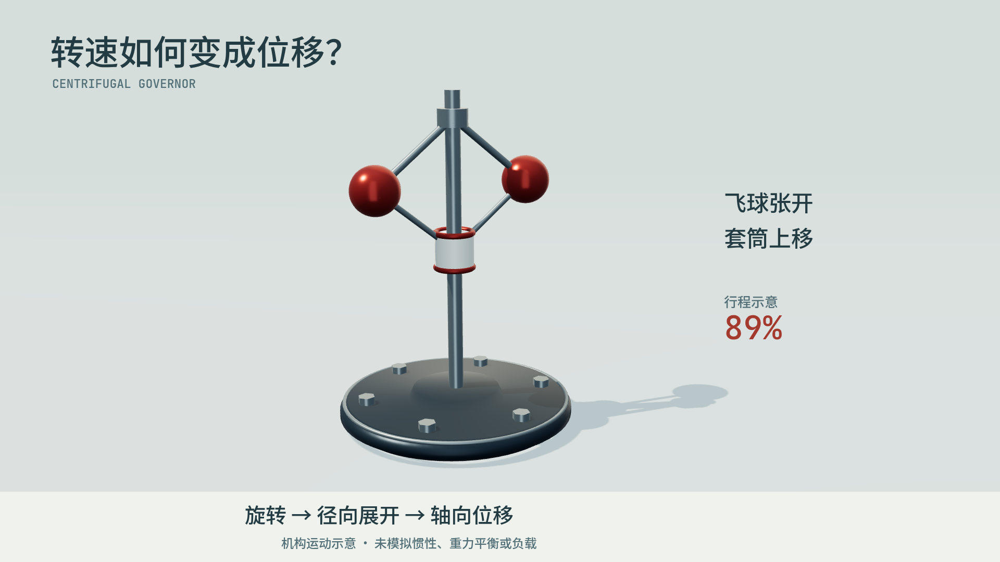

# 六秒复杂镜头：旋转变成位移

这里只验证复杂镜头的执行方法，不再制作第二组长片。[有声MP4](https://raw.githubusercontent.com/Xuanyi-king/vibe-knowledge-film/feat/director-evidence-workflow/evidence/governor_scene/final.mp4) · [源码](film.js) · [姿态/后端核验](../../evidence/governor_scene/technical.json) · [媒体报告](../../evidence/governor_scene/media.json)。



23个网格组成固定轴、旋转父节点、等长连杆、飞球、滑动轴套与底座。Three.js负责深度、反射、阴影、相机和标准几何，场景层提供旋转体与端点杆件，模型不必实现投影、面排序或法线算法。
同一姿态的[无受光消融](../../evidence/governor_scene/flat.png)使用不受光材质：可见反射/阴影怎样帮助读出球体、杆件与地面接触。这是技术消融，**不是模型能力对照**。

几何：顶点H=2.65，杆长L=.9；张角θ从.23至.95弧度。球为`(±Lsinθ,H−Lcosθ,0)`，轴套为`H−2Lcosθ`。测试确认四杆长度误差小于1e−7；实际采样最大误差1.11e−16。行程百分比由轴套实际位移归一化。
旋转角对预定义角速度解析积分，每次从t赋姿态；没有帧间累积。**这是运动学示意，不是惯性、重力平衡、负载或蒸汽阀门的动力学仿真**，字幕已说明。

第一次看图发现远处地平线切过英文标题，加入雾与一致背景消除硬边；行程读数从缓动进度改为实际位移比例。之后查看1/3/5秒帧、0–6秒Motion Strip和编码抽帧。没有添加装饰性粒子、景深或运动模糊。

```bash
python engine/get_scene_assets.py
python engine/render.py examples/governor_scene --stills 1 3 5
python engine/render.py examples/governor_scene --motion 0 6
python engine/render.py examples/governor_scene --det
python engine/render.py examples/governor_scene --resume 2
python engine/render.py examples/governor_scene --events
python engine/audio.py examples/governor_scene
python scripts/check_media.py examples/governor_scene/renders/final.mp4 --duration 6
```

同一命令再次执行会验证并复用3段。初次集成版本实测warm恢复4.923秒，0段重绘、3段复用，raw文件SHA256前后相同；这是本环境单次恢复耗时，不是跨后端速度排名。后来收紧输入追踪会使旧缓存失效；当前行为以自动化测试为准。首次冷渲染未单独计时，开发期间输入变更曾触发缓存拒绝发布，未将该次当成成功结果。

实测Linux、Chromium154、SwiftShader软件WebGL2，未在Windows/GPU硬件驱动上实测。逐帧截图有ReadPixels驱动性能提示，软件渲染较慢。测试同环境乱序seek像素一致，不承诺跨GPU逐字节一致。完整解码通过不等于主观听感验收。
