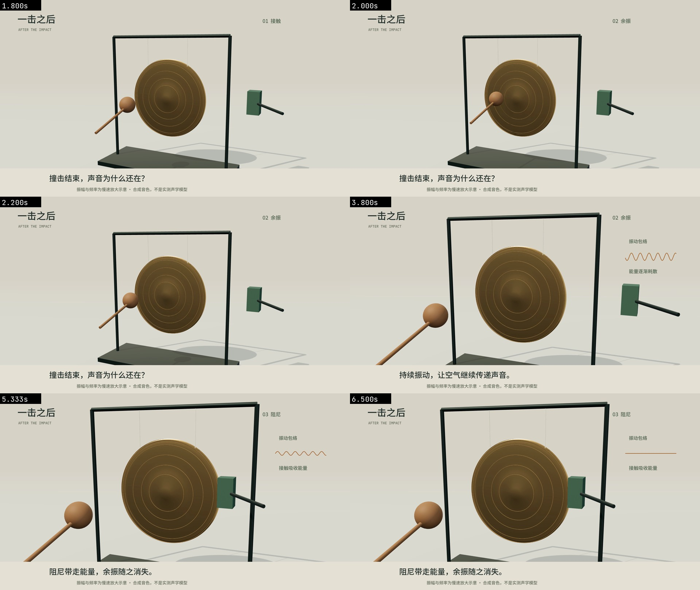

# 一击之后 · 8秒原创视听镜头

[有声MP4](https://raw.githubusercontent.com/Xuanyi-king/vibe-knowledge-film/feat/director-evidence-workflow/evidence/resonance/final.mp4) · [音效独听](https://raw.githubusercontent.com/Xuanyi-king/vibe-knowledge-film/feat/director-evidence-workflow/evidence/resonance/sfx.flac) · [音乐独听](https://raw.githubusercontent.com/Xuanyi-king/vibe-knowledge-film/feat/director-evidence-workflow/evidence/resonance/music.flac) · [参考混音](https://raw.githubusercontent.com/Xuanyi-king/vibe-knowledge-film/feat/director-evidence-workflow/evidence/resonance/score.flac)



## 创作决定与事实边界

问题：撞击结束后为什么还有声音？核心是储存的机械振动能量逐渐耗散；接触阻尼加快耗散。参考物理：有阻尼振子 `x''+2ζωx'+ω²x=0`，欠阻尼包络为`exp(-ζωt)`；声波来自振动物体与空气的耦合。这里不推导圆板振型，不测量材料参数，不声称波形是麦克风录音。

候选A是冲量→指数衰减的纯数学动态图，精确但难看到接触；候选B是悬挂铜色圆板、木槌和毡块，能让接触与安静形成可观察的因果。选择B，保留一个从实物到包络的简短过渡，不另开图表镜头。

美术：温灰实验台、氧化铜色、木与深绿毡，绿色只表示耗能接触。整体机位先保持，敲击后靠近，关键动作始终在画面中。没有粒子、炫光或无意义震屏。微表面与曲面改变实际法线/粗糙度，反射和接触影由公共场景层产生。

**示意边界**：可见圆板运动是慢速放大的刚体次级响应，并未模拟圆板弯曲振型；听到的是220Hz等非整数模态的原创合成激励，非真实铜锣录音。木槌的接近/回弹是有明确接触速度的编排，不是完整碰撞仿真。字幕明确告知慢速放大与非实测模型；不得从动画读取材料频率/能量的定量值。

## 分镜与共同事件

| 秒 | 可见任务 | 声音与观看意图 |
|---|---|---|
| 0–1.3 | 识别槌、圆板和分离的毡块，安静建立关系 | 稀疏拨弦提示开头；没有默认Drone |
| 1.3–2 | 加速靠近，2秒发生接触 | 轻气流后接模态冲击；触发、材质、力度共读strike事件 |
| 2–4.3 | 槌回弹并停稳，圆板余振；相机在2.7秒后才靠近 | 音乐退让，留下材质尾部；包络从同一衰减数据出现 |
| 4.78–5.333 | 毡块靠近并接触边缘 | 速度包络驱动短摩擦声，接触后余音与可见振动快速消退 |
| 5.72–6 | 包络成为直线，机位保持 | 所有轨与尾音共同静音，停止是知识结论 |
| 6–8 | 留出阅读与稳定尾帧 | 简短音乐返回后收束，不再添加动作音 |

## 调用与验证

```powershell
python engine/get_scene_assets.py
python engine/render.py examples/resonance --stills 2 3.8 5.333 6.5
python engine/render.py examples/resonance --motion 1.7 2.5
python engine/render.py examples/resonance --det
python engine/render.py examples/resonance --resume 2
python engine/render.py examples/resonance --events
python engine/audio.py examples/resonance --stems
python scripts/check_av.py examples/resonance
python scripts/check_media.py examples/resonance/renders/final.mp4 --duration 8
```

`film.js`只组装对象和艺术布局，复用公共`solid/lathe/rod/surface/studio`与`camera/contact/impulse/track`；`score.mjs`定义音乐与动作，没有另写一套合音器。接触速度从同一motion参数推导；改变strike拍号会同时改变槌/余振/冲击声时刻。

[最终编码接触表](../../evidence/resonance/encoded.jpg) · [动作条](../../evidence/resonance/motion.jpg) · [技术媒体报告](../../evidence/resonance/media.json) · [同步报告](../../evidence/resonance/sync.json) · [返工记录](review.md)。短验证片和无损压缩独听轨随证据追踪；36秒大样片使用历史commit固定链接。当前环境Release附件上传401，未发布Release，字节数和SHA256见[assets.json](../../evidence/assets.json)。没有重新制作两部36秒影片。

已检查关键画面、动作中间态和编码抽帧；技术测试不能代替主观听音。当前无音频播放能力，音色、混音舒适度与完整节奏留待人工审片；不宣称已达电影级。不包含真实目标模型A/B结果。
